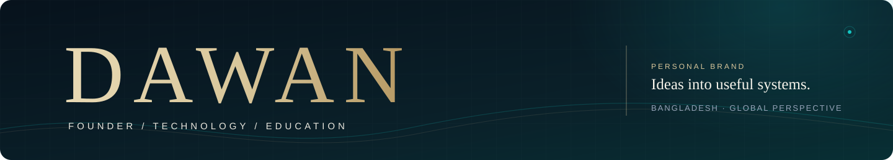
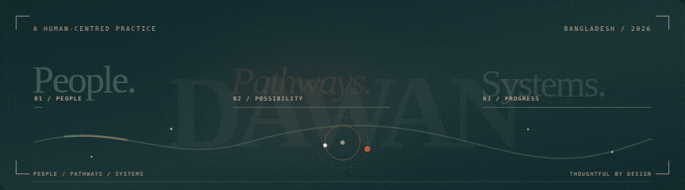
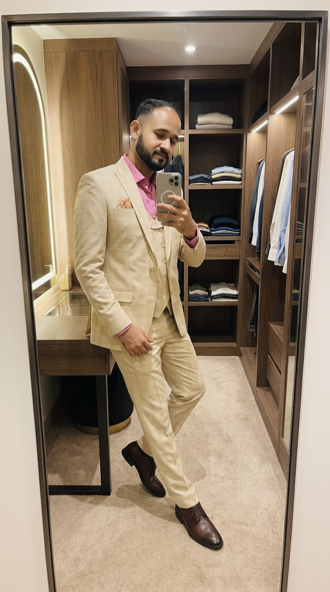
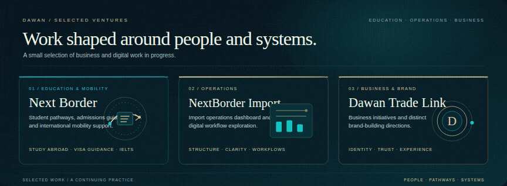
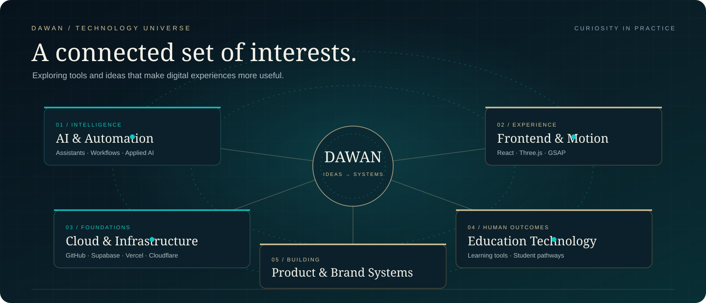
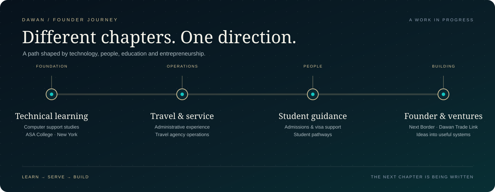
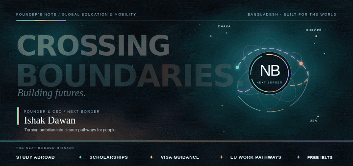
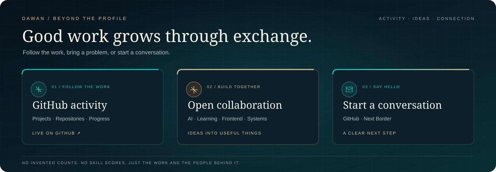

**Founder & CEO, Next Border** · Education access · Global mobility · Digital systems

 

ISHAK DAWAN · BANGLADESH

---

## Ishak Dawan

I work across technology, education, business and digital experiences. I enjoy turning complicated ideas into useful, human-centred systems.

### What I’m exploring

- **AI & automation** — practical tools that make work simpler
- **Frontend craft** — thoughtful interfaces, interaction and motion
- **Education access** — student pathways and learning experiences
- **Brand building** — clear identities and useful digital ventures

### Selected ventures

A focused view of the work across education, operations and business.

| Venture | Focus | Explore |
|---|---|---|
| **NextBorder** | Education and visa consultancy experience | [Website](https://www.nextborder.online) · [Repository](https://github.com/dawancolor-cell/next-border) |
| **NextBorder Import** | Import operations dashboard and digital workflows | [Repository](https://github.com/dawancolor-cell/nextborder-import) |
| **Dawan Trade Link** | Business and brand initiatives | Business focus |

### Technology universe

The tools and disciplines I’m exploring to connect thoughtful design with useful systems.

Areas of exploration, not proficiency ratings.

### Founder journey

A few chapters that shaped the way I work. This timeline is intentionally undated where exact milestones have not been confirmed.

### Founder & CEO · Next Border

As Founder & CEO of [Next Border](https://www.nextborder.online), I work on clearer international education and mobility pathways — from study-abroad admissions guidance and scholarship options to visa-file preparation, EU work pathways and free IELTS learning.

**Explore:** [NextBorder.online](https://www.nextborder.online) · [Free IELTS practice](https://www.nextborder.online/ielts-speaking-mock) · [Book a consultation](https://www.nextborder.online/#consultation)

---

## Activity & collaboration

I use this profile to share projects, experiments and ideas as they evolve. GitHub keeps the live contribution graph and activity timeline on my profile.

**Follow the work:** [GitHub activity & contributions](https://github.com/dawancolor-cell?tab=overview) · [Browse repositories](https://github.com/dawancolor-cell?tab=repositories)

### What I’m open to exploring together

- Practical AI and automation for everyday workflows
- Education technology, accessible learning and student pathways
- Distinctive frontend experiences, purposeful motion and digital storytelling
- Useful product and workflow systems for teams and businesses

A good collaboration starts with a clear problem, a small experiment and honest learning.

### Say hello

For project and technology conversations, connect through GitHub. For Next Border education and mobility enquiries, visit the website or use the consultation page.

**Connect:** [GitHub](https://github.com/dawancolor-cell) · [NextBorder.online](https://www.nextborder.online) · [Book a consultation](https://www.nextborder.online/#consultation)

---

### Design point of view

A good digital experience should feel considered, not generated. I value expressive colour, strong typography, purposeful motion and clear information hierarchy.

Based in Bangladesh · Open to thoughtful collaborations
