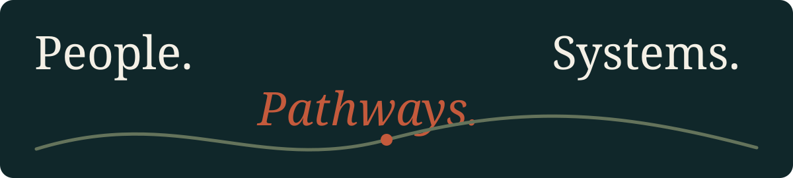

*Founder-minded builder · Technology · Education · Digital experiences*

 

ISHAK DAWAN · BANGLADESH

---

## Ishak Dawan

I work across technology, education, business and digital experiences. I enjoy turning complicated ideas into useful, human-centred systems.

### What I’m exploring

- **AI & automation** — practical tools that make work simpler
- **Frontend craft** — thoughtful interfaces, interaction and motion
- **Education access** — student pathways and learning experiences
- **Brand building** — clear identities and useful digital ventures

### Selected work

| Project | Focus |
|---|---|
| **NextBorder** | Education and visa consultancy experience |
| **Dawan Trade Link** | Business and brand initiatives |

### Design point of view

A good digital experience should feel considered, not generated. I value strong typography, purposeful motion, restrained colour and clear information hierarchy.

Based in Bangladesh · Open to thoughtful collaborations
